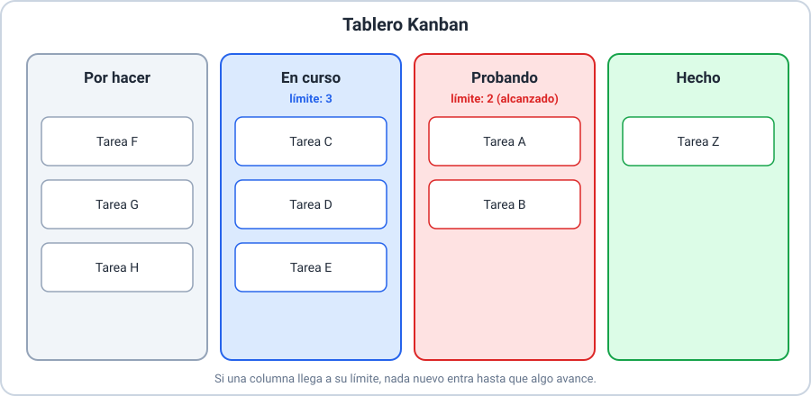

# 📘 Ejemplo 04 — El mismo proyecto con metodologías ágiles

## 🧱 Situación inicial

Se retoma el **sistema de turnos para una clínica** del Ejemplo 03. Esta vez la clínica
todavía no sabe exactamente qué necesitará, quiere empezar a usar algo pronto y espera que
las prioridades cambien. El equipo analiza tres enfoques ágiles.

## 🔍 Análisis paso a paso

1. **Con Kanban.**
   - El equipo arma un tablero con las columnas "Por hacer", "En curso", "Probando" y
     "Hecho".
   - Acuerda un **límite de trabajo en curso**: no más de tres tarjetas en "En curso".
   - Un día nota que "Probando" se llena y nada pasa a "Hecho": ahí está el cuello de botella
     y el equipo decide reforzar las pruebas antes de abrir tareas nuevas.
   - La política explícita: una tarjeta está "Hecha" cuando recepción la probó.
   - _Qué aporta_: ver el flujo y evitar abrir demasiadas tareas a la vez.
2. **Con ideas de Lean.**
   - El equipo revisa el proceso e identifica **desperdicios**: la aprobación de cada pantalla
     tarda días en una cola, y una función de "estadísticas" que nadie pidió está casi lista.
   - Aplica "eliminar desperdicios" (quita las esperas y deja la función de estadísticas para
     después) y "entregar lo más rápido posible" (publica primero el pedido de turnos).
   - _Qué aporta_: foco en el valor para la clínica.
   - _Importante_: Lean no define un tablero ni reuniones; son principios que guían las
     decisiones.
3. **Con prácticas de XP.**
   - Dos personas **programan juntas** la pantalla de confirmación.
   - Antes de programar, escriben una **prueba** que dice cuándo la confirmación funciona.
   - **Integran** su trabajo varias veces al día para detectar choques temprano.
   - _Qué aporta_: calidad técnica y retroalimentación rápida.
4. **Lo que tienen en común.** Entregan algo útil pronto, esperan cambios y colaboran con la
   clínica. Pero cada uno se centra en algo distinto: el flujo (Kanban), el valor y el
   desperdicio (Lean), la calidad técnica (XP).
5. **No mezclar atribuciones.** El tablero con límites **no** es de Lean ni de XP;
   programar en parejas **no** es de Kanban.

## ✅ Resultado esperado

| | Kanban | Lean | XP |
|---|---|---|---|
| Idea central | Visualizar y limitar el flujo | Eliminar desperdicio y entregar valor | Calidad técnica y colaboración |
| Qué se vio en el sistema de turnos | Tablero con límite de trabajo en curso | Quitar esperas y funciones no pedidas | Parejas, pruebas primero e integración continua |
| Tipo | Método de gestión del flujo | Filosofía | Conjunto de prácticas de ingeniería |

