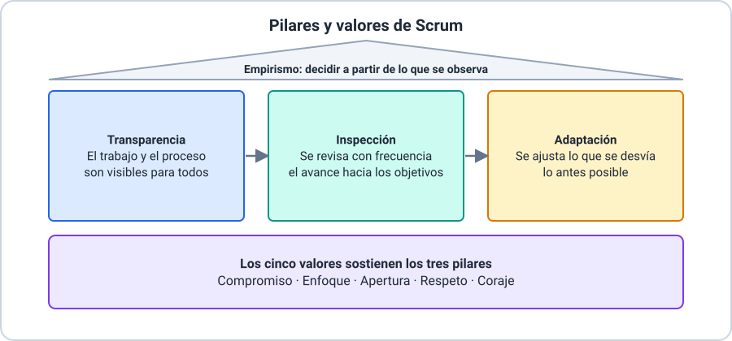

# 📘 Ejemplo 02 — Pilares y valores en un equipo

## 🧱 Situación inicial

Un equipo de soporte de una tienda en línea trabaja con Scrum. Estas son ocho cosas que pasaron
durante un sprint:

- **a.** Todas las tareas del sprint están en un tablero que ve todo el equipo y los
  interesados.
- **b.** Cada día el equipo revisa cuánto avanzó hacia el objetivo del sprint.
- **c.** Al ver en la revisión que los usuarios no usaban una función, el equipo cambia lo que
  va a construir en el siguiente sprint.
- **d.** Un *Developer* admite que no sabe cómo resolver una tarea y pide ayuda al resto.
- **e.** El equipo se compromete a lograr el objetivo del sprint y a apoyarse mutuamente.
- **f.** El equipo deja de lado dos tareas secundarias para concentrarse en el objetivo del
  sprint.
- **g.** El equipo escucha con atención una opinión distinta a la suya antes de decidir.
- **h.** Una desarrolladora plantea abiertamente un problema incómodo que pone en riesgo el
  plazo, en lugar de ocultarlo.

## 🔍 Análisis paso a paso

1. **Separar pilares de valores.** Los **pilares** son tres (transparencia, inspección,
   adaptación) y describen cómo se trabaja. Los **valores** son cinco (compromiso, enfoque,
   apertura, respeto, coraje) y describen cómo se comporta el equipo.
2. **Los pilares (a, b, c).** (a) hace el trabajo visible: **transparencia**. (b) revisa el
   progreso hacia un objetivo: **inspección**. (c) cambia el rumbo ante lo observado:
   **adaptación**.
3. **Los valores (d a h).** (d) admitir que no se sabe y pedir ayuda: **apertura**. (e) lograr
   los objetivos del equipo y apoyarse: **compromiso**. (f) concentrarse en el trabajo del
   sprint: **enfoque**. (g) escuchar una opinión distinta: **respeto**. (h) plantear un
   problema difícil: **coraje**.
4. **Ver cómo se conectan.** Sin (a) no podría haber (b): no se puede inspeccionar lo que no se
   ve. Sin (b) no habría nada que adaptar en (c). Y (h) hace posible la transparencia: si
   nadie se anima a mostrar un problema, el tablero miente.

## ✅ Resultado esperado

| Situación | Pilar o valor |
|---|---|
| a | Pilar: **transparencia** |
| b | Pilar: **inspección** |
| c | Pilar: **adaptación** |
| d | Valor: **apertura** |
| e | Valor: **compromiso** |
| f | Valor: **enfoque** |
| g | Valor: **respeto** |
| h | Valor: **coraje** |

> 📌 Estos pilares y valores son los de **Scrum**; no son los cuatro valores del manifiesto ágil
> de la Clase 01.

