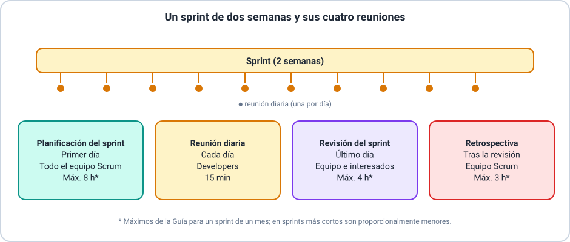

# 📘 Ejemplo 05 — Reuniones del sprint

## 🧱 Situación inicial

Seguimos con la **aplicación para reservar canchas de pádel** (Ejemplos 03 y 04). El equipo
trabaja en sprints de **dos semanas**. Se quiere entender, para cada reunión del sprint 1, para
qué sirve, quién participa, cuánto dura como máximo y qué produce.

## 🔍 Análisis paso a paso

1. **Planificación del sprint (primer día).** Participa todo el equipo Scrum. Lucía propone cómo
   el producto puede aumentar su valor, el equipo acuerda el objetivo del sprint, los *Developers*
   eligen qué elementos entran y planifican cómo hacerlo. Produce el **objetivo del sprint y la
   lista del sprint**.
2. **Reunión diaria (cada día).** Participan los *Developers*. Dura como máximo **15 minutos**,
   siempre a la misma hora y en el mismo lugar. Revisan cuánto avanzaron hacia el objetivo del
   sprint y ajustan el plan del día. Si Mateo o Lucía trabajan en elementos de la lista del sprint,
   participan como *Developers*.
3. **Revisión del sprint (último día).** Participan el equipo Scrum y los interesados clave (por
   ejemplo, jugadores y el dueño del club). Miran el incremento, conversan sobre lo logrado y
   deciden qué sigue. Produce una **lista del producto ajustada**.
4. **Retrospectiva (después de la revisión).** Participa el equipo Scrum. Revisa cómo fue el
   sprint respecto de las personas, las interacciones, los procesos, las herramientas y la
   definición de terminado, y acuerda mejoras. Produce **mejoras acordadas**.
5. **Corregir dos malentendidos.**
   - *«Mateo pide a cada uno un informe en la reunión diaria»*: la reunión diaria es de los
     *Developers* y para ellos; sirve para revisar el avance hacia el objetivo del sprint y
     ajustar el plan, no para informar a un jefe.
   - *«La revisión es solo una demostración»*: es una sesión de trabajo donde el equipo y los
     interesados deciden juntos qué sigue.
6. **Sobre los tiempos.** Los máximos de la tabla son los de un **sprint de un mes**. Como este
   sprint dura dos semanas, las reuniones son proporcionalmente más breves (por ejemplo, la
   planificación ronda la mitad de las ocho horas).

## ✅ Resultado esperado

| Reunión | Propósito | Participan | Máximo (sprint de un mes) | Resultado |
|---|---|---|---|---|
| Planificación del sprint | Planificar el trabajo del sprint | Todo el equipo Scrum | 8 horas | Objetivo del sprint y lista del sprint |
| Reunión diaria | Inspeccionar el avance hacia el objetivo y adaptar el plan | *Developers* | 15 minutos | Plan para el día |
| Revisión del sprint | Inspeccionar el resultado y decidir qué sigue | Equipo Scrum e interesados | 4 horas | Lista del producto ajustada |
| Retrospectiva | Mejorar la calidad y la forma de trabajar | Equipo Scrum | 3 horas | Mejoras acordadas |

> 📌 La revisión inspecciona **el producto**; la retrospectiva inspecciona **la forma de
> trabajar**.

