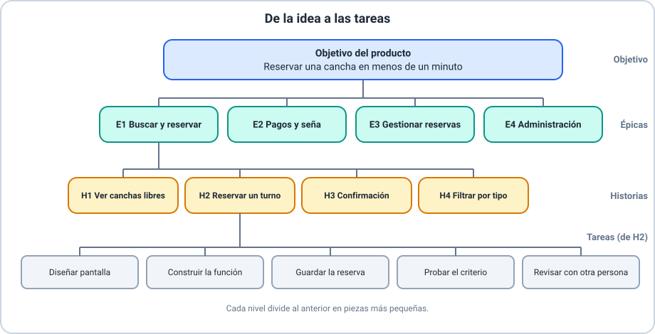

# 📘 Ejemplo 02 — De la idea a las épicas

## 🧱 Situación inicial

Lucía, la *Product Owner* de la **aplicación para reservar canchas de pádel**, tiene en la cabeza
muchas ideas sueltas:

- Ver qué canchas están libres.
- Reservar un turno.
- Pagar la seña.
- Recibir un mensaje de confirmación.
- Cancelar o cambiar una reserva.
- Que el club cargue sus canchas y horarios.
- Filtrar canchas por tipo.
- Ver mis reservas anteriores.

Hay que ordenarlas. Todavía no son historias: son ideas de distinto tamaño.

## 🔍 Análisis paso a paso

1. **Escribir el objetivo del producto.** Lucía lo resume en una frase comprobable: *«Que
   cualquier jugador pueda reservar una cancha en menos de un minuto»*. Expresa el valor del
   producto y se puede medir.
2. **Agrupar las ideas por propósito.** Las ideas de «ver canchas», «reservar», «confirmación» y
   «filtrar» sirven para encontrar y reservar. Las de «pagar la seña» tienen que ver con pagos.
   «Cancelar o cambiar» y «ver mis reservas» tratan de gestionar reservas. «Cargar canchas y
   horarios» es de la administración del club.
3. **Nombrar cada grupo y darle un propósito.** Cada grupo es una **épica**.
4. **Comprobar que son épicas y no historias.** Ninguna cabe en un sprint: cada una necesita
   varias historias.
5. **Ordenar el Product Backlog.** Lucía pone primero lo que más aporta al objetivo del producto:
   E1 (sin buscar y reservar no hay producto), luego E2, E3 y, al final, E4.
6. **Recordar el origen.** El Product Backlog y el objetivo del producto son de la Guía de
   Scrum; la épica es una práctica habitual.

## ✅ Resultado esperado

| Orden | Épica | Propósito | Ideas que agrupa |
|---|---|---|---|
| 1 | **E1** Buscar y reservar canchas | Que el jugador encuentre una cancha libre y la reserve | Ver canchas libres, reservar, confirmación, filtrar por tipo |
| 2 | **E2** Pagos y seña | Que el jugador pueda pagar la seña | Pagar la seña |
| 3 | **E3** Gestionar mis reservas | Que el jugador vea, cambie o cancele reservas | Cancelar o cambiar, ver mis reservas |
| 4 | **E4** Administración del club | Que el club cargue canchas y horarios | Cargar canchas y horarios |

**Objetivo del producto:** que cualquier jugador pueda reservar una cancha en menos de un minuto.

