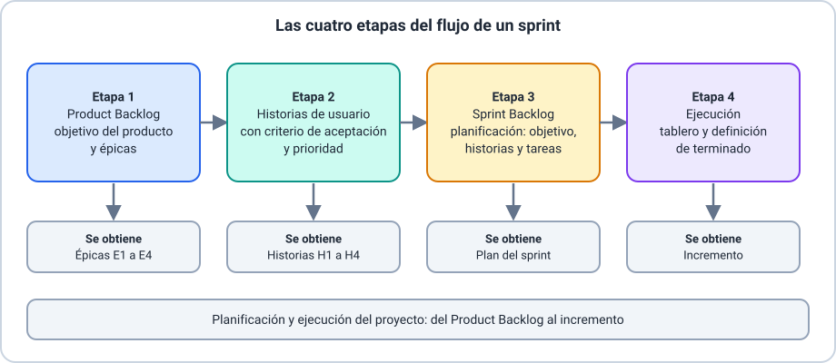
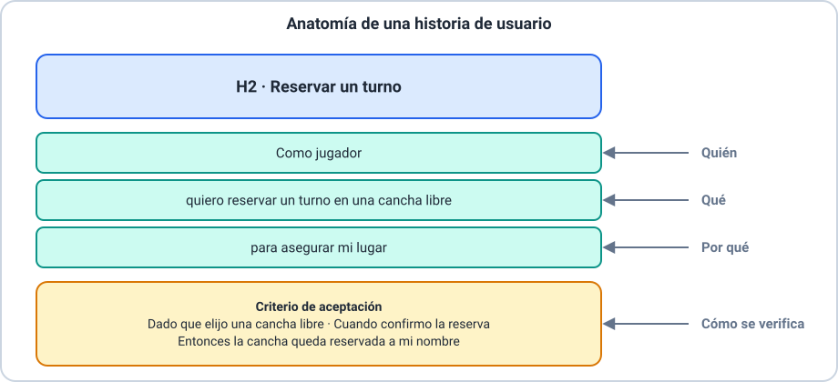
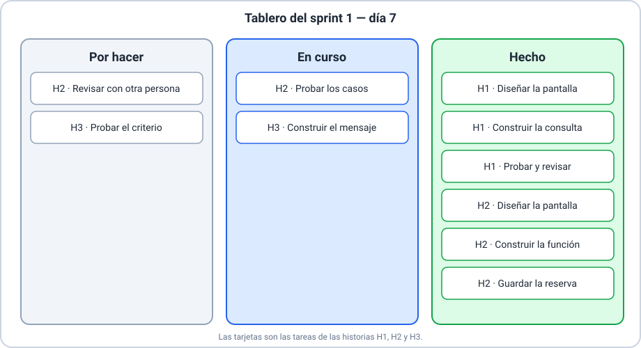

# 📚 Explicación conceptual — Planificación y ejecución de proyectos

Esta clase pone en práctica lo que viste en la Clase 02: roles, artefactos y reuniones de Scrum. Se
recomiendan las Clases 01 y 02, pero repasamos lo necesario. No hace falta saber programar.

Resultados de aprendizaje de la clase:

- **RA-1**: describir el flujo de un sprint y ubicar en él las cuatro etapas.
- **RA-2**: construir un *Product Backlog*: objetivo del producto y épicas.
- **RA-3**: redactar historias de usuario con criterio de aceptación y prioridad.
- **RA-4**: planificar un sprint y formar el *Sprint Backlog*.
- **RA-5**: ejecutar un sprint con un tablero y aplicar la definición de terminado.
- **RA-6**: aplicar el ciclo completo en un proyecto de práctica.

## 🗒️ Glosario

Seguimos usando los términos de Scrum en inglés, con su equivalente la primera vez.

| Término | Equivalente |
|---|---|
| *Product Backlog* | lista del producto |
| *Sprint Backlog* | lista del sprint |
| *Sprint* | ciclo de trabajo de duración fija |
| *Product Owner* | dueño del producto |
| *Developers* | desarrolladores |
| *Increment* | incremento |
| *Definition of Done* | definición de terminado |

> 📌 **Origen de cada concepto.** Algunos conceptos de esta clase vienen de la **Guía de Scrum**
> (Product Backlog, Sprint Backlog, objetivos, incremento y definición de terminado). Otros son
> **prácticas habituales** que los equipos usan con Scrum, pero que **no están en la guía**: épica,
> historia de usuario, criterio de aceptación, tarea y tablero. Te lo avisamos cada vez.

---

## 🔄 El flujo de un sprint y sus cuatro etapas

_Resultados de aprendizaje: RA-1_

> 🔗 **Ejemplos de este concepto**
>
> - [Ejemplo 01 — El flujo en cuatro etapas](01-flujo-en-cuatro-etapas.md): recordatorio del proyecto de canchas de pádel y recorrido de las cuatro etapas.

### 🌍 Contexto

En la Clase 02 viste que un sprint es un ciclo de duración fija que produce un incremento. Pero
antes de que empiece el sprint hay que saber **qué** se va a construir, y durante el sprint hay que
saber **cómo va** el trabajo. Esta clase recorre ese camino completo, en cuatro etapas.

### 💡 Concepto

| Etapa | Qué se hace | Qué se obtiene | Origen |
|---|---|---|---|
| **1. Product Backlog** | Se define el objetivo del producto y se organiza el trabajo en épicas | Una lista del producto con épicas | Guía de Scrum (la lista); la épica es práctica habitual |
| **2. Historias de usuario** | Se detalla cada épica en historias con criterio de aceptación y prioridad | Historias ordenadas | Práctica habitual |
| **3. Sprint Backlog** | En la planificación se acuerda el objetivo del sprint y se eligen historias, que se descomponen en tareas | La lista del sprint | Guía de Scrum (la lista); las tareas son práctica |
| **4. Ejecución** | Se trabaja el sprint, se sigue el avance en un tablero y se aplica la definición de terminado | Un incremento utilizable | Guía de Scrum (incremento); el tablero es práctica |

### 📖 Explicación

Las etapas 1 y 2 ocurren sobre el **Product Backlog**, que gestiona el *Product Owner*. La etapa 3
ocurre en la **planificación del sprint**, con todo el equipo. La etapa 4 ocupa el resto del
sprint, con la **reunión diaria** como momento de mirar el tablero. Al terminar, la **revisión** y
la **retrospectiva** cierran el ciclo y el Product Backlog se ajusta para el siguiente sprint.

Durante toda la clase seguimos un mismo proyecto: una **aplicación para reservar canchas de
pádel**, con un objetivo del producto que ya conocés: *que cualquier jugador pueda reservar una
cancha en menos de un minuto*.

---

## 🧱 Etapa 1 — Product Backlog: objetivo del producto y épicas

_Resultados de aprendizaje: RA-2_

> 🔗 **Ejemplos de este concepto**
>
> - [Ejemplo 02 — De la idea a las épicas](02-de-la-idea-a-las-epicas.md): del objetivo del producto a las cuatro épicas de la aplicación de canchas.

### 🌍 Contexto

Un producto empieza con una idea general. Para poder trabajarla hay que ordenarla: saber a dónde
se quiere llegar y en qué grandes bloques se divide el camino.

### 💡 Concepto

El **Product Backlog** (lista del producto) es una lista **ordenada y en constante cambio** de lo
que se necesita para mejorar el producto. Su compromiso es el **objetivo del producto**: la meta a
largo plazo del equipo. Lo gestiona el *Product Owner*, que es una sola persona.

> 📌 **Origen.** El Product Backlog y el objetivo del producto vienen de la **Guía de Scrum**.

Una **épica** es una agrupación **grande** de trabajo: un proyecto o una capacidad completa del
producto, que no cabe en un sprint y que se divide en historias más pequeñas.

> 📌 **Origen.** La épica es una **práctica habitual**: la Guía de Scrum no la define. En la
> práctica, una épica es un conjunto de historias grandes que comparten un propósito.

### 📖 Explicación

**Cómo pasar de la idea a las épicas:**

1. **Escribí el objetivo del producto**: qué valor busca el producto y cómo se sabrá si se logró.
   *Ejemplo:* «Que cualquier jugador pueda reservar una cancha en menos de un minuto».
2. **Identificá las grandes capacidades** que el producto necesita para cumplir ese objetivo.
3. **Dale a cada una un nombre y un propósito**: eso es una épica.

*Ejemplo: las épicas de la aplicación de canchas.*

| Épica | Propósito |
|---|---|
| **E1** Buscar y reservar canchas | Que el jugador encuentre una cancha libre y la reserve |
| **E2** Pagos y seña | Que el jugador pueda pagar la seña de su reserva |
| **E3** Gestionar mis reservas | Que el jugador vea, cambie o cancele sus reservas |
| **E4** Administración del club | Que el club cargue canchas y horarios |

Una épica **no se trabaja entera en un sprint**: primero se la divide en historias. Y el Product
Backlog se **ordena por valor**: lo más importante para el objetivo del producto va primero.

---

## 📝 Etapa 2 — Historias de usuario

_Resultados de aprendizaje: RA-3_

> 🔗 **Ejemplos de este concepto**
>
> - [Ejemplo 03 — De una épica a historias](03-de-una-epica-a-historias.md): de la épica E1 a las historias H1 a H4, con criterio de aceptación, y una historia demasiado grande que se divide.

### 🌍 Contexto

Una épica es demasiado grande para planificar. Hace falta partirla en piezas pequeñas, cada una
con valor propio, que se puedan construir y comprobar en poco tiempo.

### 💡 Concepto

Una **historia de usuario** describe, en pocas palabras, **un valor desde el punto de vista de
quien usa el producto**. Tiene tres partes:

| Parte | Formato | Ejemplo |
|---|---|---|
| Quién | **Como** [quién] | Como jugador |
| Qué | **quiero** [qué] | quiero reservar un turno en una cancha libre |
| Por qué | **para** [por qué] | para asegurar mi lugar |

El **criterio de aceptación** son las condiciones que hay que comprobar para saber si la historia
funciona. Una forma recomendada de escribirlos es **«dado…, cuando…, entonces…»**:

> *Dado que elijo una cancha libre, cuando confirmo la reserva, entonces la cancha queda reservada a mi nombre.*

La **prioridad** es el lugar de la historia en el Product Backlog: se ordena por el valor que
aporta y por las dependencias.

> 📌 **Origen.** La historia de usuario, el formato «como, quiero, para» y el criterio de
> aceptación son **prácticas habituales**, no parte de la Guía de Scrum. Las historias surgieron
> en Programación Extrema (Clase 01) en los años noventa, y el formato más usado lo popularizó un
> equipo de Connextra en 2001. Existen otros formatos de criterio de aceptación; «dado, cuando,
> entonces» es el que usamos acá.

### 📖 Explicación

**Historia frente a tarea.** Son cosas distintas:

| | Historia de usuario | Tarea |
|---|---|---|
| Qué describe | Un **valor** para quien usa el producto | Un **paso** del equipo para entregarlo |
| Quién la redacta | El *Product Owner* con el equipo | Los *Developers* |
| Ejemplo | Reservar un turno | Diseñar la pantalla de reserva |

**Historia demasiado grande.** Si una «historia» no cabe en un sprint, es una **épica disfrazada**:
hay que dividirla. *Ejemplo:* «Como jugador quiero administrar mis reservas» es muy grande; se
divide en *ver mis reservas*, *cancelar una reserva* y *cambiar el horario de una reserva*. Cada
parte sigue aportando valor por sí sola.

**Lo que hace buena a una historia:** es pequeña (cabe en un sprint), aporta valor y tiene un
criterio de aceptación que se puede comprobar. Sin criterio de aceptación no hay forma de saber si
está terminada.

---

## 🗓️ Etapa 3 — Planificación y Sprint Backlog

_Resultados de aprendizaje: RA-4_

> 🔗 **Ejemplos de este concepto**
>
> - [Ejemplo 04 — Planificar el sprint](04-planificar-el-sprint.md): objetivo del sprint, selección de historias, tareas y Sprint Backlog del proyecto de canchas.

### 🌍 Contexto

Con un Product Backlog ordenado, llega la planificación del sprint: el equipo decide qué se
compromete a construir en el próximo ciclo.

### 💡 Concepto

El **Sprint Backlog** (lista del sprint) tiene **tres partes**:

| Parte | Responde | Ejemplo |
|---|---|---|
| **Objetivo del sprint** | ¿Por qué es valioso este sprint? | Que un jugador pueda ver las canchas libres y reservar un turno |
| **Historias elegidas** | ¿Qué se puede hacer en este sprint? | H1, H2 y H3 |
| **Plan de tareas** | ¿Cómo se hará el trabajo? | Las tareas de cada historia |

Su compromiso es el **objetivo del sprint**.

> 📌 **Origen.** El Sprint Backlog y el objetivo del sprint vienen de la **Guía de Scrum**. Las
> historias y las tareas son prácticas habituales con las que se completa.

### 📖 Explicación

**Cómo se planifica:**

1. **Formulá el objetivo del sprint.** Es una meta breve que da un propósito común al trabajo.
2. **Mirá la capacidad.** En esta clase, la capacidad es un **número de historias pequeñas** que el
   equipo suele completar en un sprint de dos semanas. *Ejemplo:* cuatro.
3. **Elegí historias del Product Backlog**, empezando por las de mayor prioridad, que
   **contribuyan al objetivo** del sprint y **no superen la capacidad**.
4. **Descomponé cada historia en tareas** concretas y breves que, hechas todas, completan la
   historia.

*Ejemplo:* con capacidad de cuatro, el equipo elige H1, H2 y H3, que apoyan el objetivo. **H4**
(filtrar canchas por tipo) quedaría dentro de la capacidad, pero **no aporta al objetivo**, así que
queda en el Product Backlog. Se elige por **objetivo**, no solo por lugar libre.

*Tareas de H2:* diseñar la pantalla de reserva, construir la función de reservar, guardar la
reserva, probar los casos del criterio y revisar con otra persona.

> 💡 No usamos puntos de historia ni otras técnicas de estimación: la capacidad se da en historias
> pequeñas. Estimar es un tema de un módulo posterior.

---

## 📋 Etapa 4 — Ejecución: tablero y definición de terminado

_Resultados de aprendizaje: RA-5_

> 🔗 **Ejemplos de este concepto**
>
> - [Ejemplo 05 — Ejecutar el sprint con el tablero](05-ejecutar-el-sprint-con-el-tablero.md): el tablero día a día, un problema de flujo, la definición de terminado, un cambio a mitad del sprint y el cierre.

### 🌍 Contexto

Con el Sprint Backlog formado, empieza el trabajo. Para que todo el equipo —y los interesados—
vea cómo va, se necesita una forma visible de seguir el avance.

### 💡 Concepto

El **tablero** muestra las tareas del sprint en columnas según su estado. Como mínimo:

| Columna | Qué contiene |
|---|---|
| **Por hacer** | Tareas que todavía no empezaron |
| **En curso** | Tareas que alguien está haciendo ahora |
| **Hecho** | Tareas terminadas |

> 📌 **Origen.** El tablero es una **práctica habitual**: la Guía de Scrum pide transparencia sobre
> el Sprint Backlog, y el tablero es una forma común de lograrla. Se arma en papel, tarjetas o un
> documento de texto; existen también herramientas digitales, que no usamos en esta clase.

La **definición de terminado** es el acuerdo del equipo sobre **cuándo algo está terminado**.
*Ejemplo:* una historia está terminada cuando (1) se probó con su criterio de aceptación, (2) la
revisó otra persona y (3) funciona en el entorno de pruebas.

> 📌 **Origen.** La definición de terminado y el incremento vienen de la **Guía de Scrum**.

### 📖 Explicación

**La reunión diaria** es el momento de mirar el tablero: los *Developers* revisan el avance hacia
el objetivo del sprint y ajustan el plan. Un **problema de flujo** se ve en el tablero: por ejemplo,
muchas tareas **en curso** y casi ninguna en **hecho**. La respuesta es **terminar antes de
empezar**: cerrar lo que está abierto antes de abrir tareas nuevas.

**Cuándo está terminada una historia:** cuando **todas sus tareas están hechas** y además se
cumplen su **criterio de aceptación** y la **definición de terminado**. Las tareas hechas no
alcanzan por sí solas.

**Al cierre del sprint:**

- Si una historia **no está terminada**, **vuelve al Product Backlog** y el *Product Owner* decide
  su lugar. **No se cuenta como terminada** y **no se alarga el sprint**.
- La duración del sprint es fija; lo que se ajusta es el alcance.

**Cambios a mitad del sprint.** El **objetivo del sprint no cambia**. Si aparece un pedido nuevo,
se conversa con el *Product Owner*: el alcance se puede renegociar, y el pedido nuevo se ubica en
el Product Backlog. Solo el *Product Owner* puede cancelar un sprint, y únicamente si el objetivo
dejó de tener sentido.

---

## 🧭 El ciclo completo y los errores frecuentes

_Resultados de aprendizaje: RA-6_

> 🔗 **Ejemplos de este concepto**
>
> - [Ejemplo 01 — El flujo en cuatro etapas](01-flujo-en-cuatro-etapas.md): el recorrido completo, visto desde arriba.
> - [Ejemplo 02 — De la idea a las épicas](02-de-la-idea-a-las-epicas.md): la etapa 1 aplicada.
> - [Ejemplo 03 — De una épica a historias](03-de-una-epica-a-historias.md): la etapa 2 aplicada, con una historia que se divide.
> - [Ejemplo 04 — Planificar el sprint](04-planificar-el-sprint.md): la etapa 3 aplicada, con un elemento que queda fuera.
> - [Ejemplo 05 — Ejecutar el sprint con el tablero](05-ejecutar-el-sprint-con-el-tablero.md): la etapa 4 aplicada, con un cierre con historia sin terminar.

### 🌍 Contexto

Llevar un proyecto con Scrum es repetir este ciclo sprint tras sprint. Conviene conocer los
errores más comunes, para reconocerlos y corregirlos a tiempo.

### 💡 Concepto

El ciclo completo, en una línea: **objetivo del producto → épicas → historias → objetivo del
sprint → Sprint Backlog → tablero → incremento → Product Backlog ajustado**.

### 📖 Explicación

**Errores frecuentes y cómo corregirlos:**

| Error | Por qué es un problema | Cómo se corrige |
|---|---|---|
| Una historia demasiado grande | No cabe en un sprint y no se sabe cuándo está terminada | Dividirla en historias más pequeñas |
| Una historia sin criterio de aceptación | No hay forma de comprobar si funciona | Escribir criterios verificables («dado, cuando, entonces») |
| Confundir historia con tarea | Se planifica por pasos técnicos y se pierde el valor | Describir el valor en la historia y los pasos en las tareas |
| Un sprint sobrecargado | No se cumple el objetivo del sprint | Elegir según el objetivo y la capacidad |
| Contar como terminada una historia sin terminar | Se miente al Product Owner y al cliente | Aplicar la definición de terminado y devolverla al Product Backlog |
| Alargar el sprint | Se pierde el ritmo y la inspección | Mantener la duración y ajustar el alcance |

**Para llevar:** el objetivo del producto da el *rumbo*, las épicas y las historias dan el *mapa*,
el objetivo del sprint da el *propósito* de cada ciclo y el tablero da la *visibilidad* del
trabajo.
