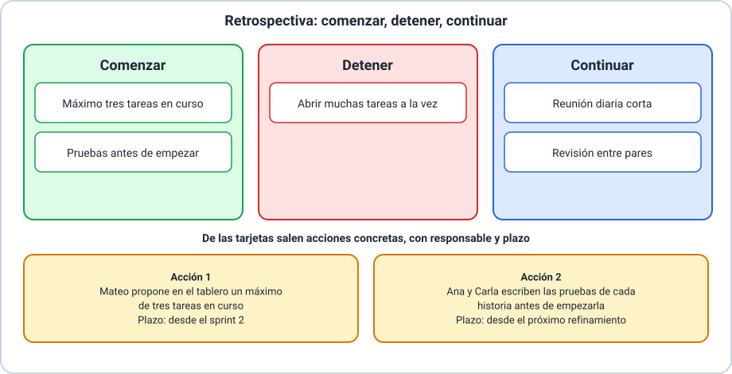

# 📘 Ejemplo 04 — La retrospectiva del sprint

## 🧱 Situación inicial

Después de la revisión (Ejemplo 03), el equipo Scrum de la **aplicación para reservar canchas de pádel** hace la
**retrospectiva del sprint 1**. Participan Lucía, Mateo, Ana, Bruno y Carla, y usan tarjetas de papel. Sobre el
sprint recuerdan, entre otras cosas: la reunión diaria fue corta, el día 4 había cinco tareas en curso y casi
nada terminado, y H3 quedó sin probar.

Quieren probar dos técnicas distintas y terminar con **acciones concretas**.

## 🔍 Análisis paso a paso

1. **Preparar el espacio.** Se sientan en ronda, con tarjetas y tres columnas dibujadas, y acuerdan que todas las
   opiniones valen y que se habla de hechos y no de personas.
2. **Recoger datos.** Cada persona escribe tarjetas sobre lo que pasó en el sprint.
3. **Primera técnica: comenzar, detener, continuar.**
   - **Continuar:** la reunión diaria corta y la revisión entre pares.
   - **Detener:** abrir muchas tareas a la vez.
   - **Comenzar:** limitar a tres las tareas en curso y escribir las pruebas antes de empezar cada historia.
4. **Segunda técnica: lo que salió bien, lo que salió mal, lo que aprendimos.**
   - **Bien:** la revisión entre pares detectó dos errores.
   - **Mal:** H3 quedó sin probar.
   - **Aprendimos:** dejar la prueba para el final es riesgoso.
5. **Elegir la técnica según el momento.** Con la primera, el equipo sale con cambios claros; con la segunda, ordena
   primero lo que pasó. Ambas llevaron a los mismos temas.
6. **Convertir las tarjetas en acciones.** No alcanza con anotar «trabajar mejor». Cada acción lleva un **responsable**
   y un **plazo**:
   - **Acción 1:** Mateo propone en el tablero un máximo de tres tareas en curso, desde el sprint 2.
   - **Acción 2:** Ana y Carla escriben las pruebas de cada historia antes de empezarla, desde el próximo
     refinamiento.
7. **Aprovechar las mejoras.** Las acciones más importantes se aplican cuanto antes: la primera ya rige en el
   sprint siguiente, y puede incluso agregarse al Sprint Backlog.
8. **Diferenciar de la revisión.** La retrospectiva inspeccionó **la forma de trabajar** del equipo, no el producto.

## ✅ Resultado esperado

| Técnica | Resultado |
|---|---|
| Comenzar, detener, continuar | Continuar: reunión diaria corta y revisión entre pares · Detener: abrir muchas tareas a la vez · Comenzar: máximo tres tareas en curso, pruebas antes de empezar |
| Bien, mal, aprendimos | Bien: la revisión entre pares detectó dos errores · Mal: H3 quedó sin probar · Aprendimos: dejar la prueba para el final es riesgoso |

| Acción | Responsable | Plazo |
|---|---|---|
| Máximo de tres tareas en curso en el tablero | Mateo | Desde el sprint 2 |
| Escribir las pruebas de cada historia antes de empezarla | Ana y Carla | Desde el próximo refinamiento |

> 📌 La retrospectiva, lo que inspecciona y que las mejoras se abordan cuanto antes son de la Guía de Scrum; las
> dos técnicas son prácticas habituales.
