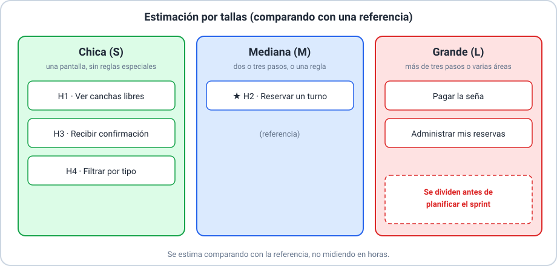
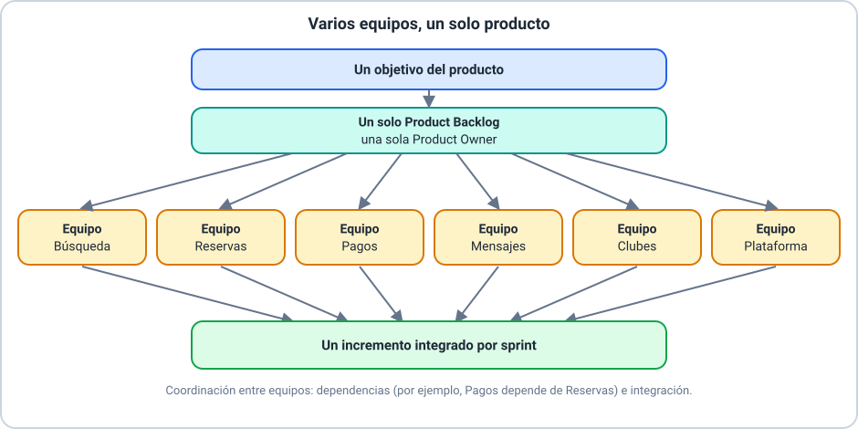

# 📚 Explicación conceptual — Refinamiento, revisión y escalamiento

Esta clase sigue al proyecto de la aplicación de canchas de pádel **después del sprint 1** de la
Clase 03. Se recomiendan las Clases 02 y 03, pero repasamos lo necesario. No hace falta saber
programar.

Resultados de aprendizaje de la clase:

- **RA-1**: explicar qué es el refinamiento del *Product Backlog*.
- **RA-2**: aplicar el refinamiento: entradas, herramientas y salidas.
- **RA-3**: conducir la revisión de un sprint.
- **RA-4**: conducir la retrospectiva de un sprint.
- **RA-5**: explicar qué significa escalar Scrum y por qué hace falta.
- **RA-6**: describir, como panorama, cómo se escala Scrum en grandes proyectos.

## 🗒️ Glosario

Seguimos usando los términos de Scrum en inglés, con su equivalente la primera vez.

| Término | Equivalente |
|---|---|
| *Product Backlog* | lista del producto |
| *Sprint Backlog* | lista del sprint |
| *Product Owner* | dueño del producto |
| *Developers* | desarrolladores |
| *Definition of Done* | definición de terminado |
| *Increment* | incremento |

> 📌 **Origen de cada concepto.** El refinamiento, la revisión y la retrospectiva vienen de la **Guía de
> Scrum**. Pero **cómo** se hacen en la práctica —las entradas, herramientas y salidas del
> refinamiento, las tallas y las técnicas de retrospectiva— son **prácticas habituales** que no están
> en la guía. Te lo avisamos cada vez.

---

## 🧹 Qué es el refinamiento

_Resultados de aprendizaje: RA-1_

> 🔗 **Ejemplos de este concepto**
>
> - [Ejemplo 01 — Refinar el Product Backlog](01-refinar-el-product-backlog.md): el Product Backlog del sprint 2 de la aplicación de canchas, refinado.

### 🌍 Contexto

En la Clase 03 planificaste un sprint a partir de un Product Backlog ordenado. Pero ese Product
Backlog no se arma solo: después de cada sprint hay elementos grandes, vagos o nuevos que hay que
preparar antes de poder planificarlos.

### 💡 Concepto

El **refinamiento** del Product Backlog es la actividad de **dividir y definir mejor** los elementos
del Product Backlog, para que sean **más pequeños y más precisos**. Es una actividad **continua**:
agrega detalles como la descripción, el orden y el tamaño.

> 📌 **Origen.** Viene de la **Guía de Scrum**. La guía lo describe como una actividad, **no como un
> evento**, y **no fija** cuánto tiempo dedicarle ni cada cuánto hacerlo.

### 📖 Explicación

**Quién participa.** El refinamiento es del equipo Scrum. Los *Developers*, que son quienes harán el
trabajo, son responsables del **tamaño**. El *Product Owner* puede influir ayudando a entender y a elegir
entre alternativas.

**Cuándo ocurre.** No tiene un momento fijo: ocurre de forma continua, a lo largo del sprint. Los
equipos suelen reservar un espacio regular para hacerlo, pero eso es una **práctica habitual** y no una
regla de Scrum.

**Cuánto tiempo dedicarle.** No hay una cifra oficial. Hay un equilibrio:

| Si se dedica… | Riesgo |
|---|---|
| Demasiado poco | La planificación se frena: llegan elementos grandes o poco claros y se discute todo ahí |
| Demasiado | Se refina más de lo que se va a construir pronto, y lo refinado queda viejo cuando cambia el contexto |

**Refinar no es estimar.** Estimar es una de las herramientas; también se divide, se aclara y se
ordena. Y **no es una reunión obligatoria de Scrum**.

---

## 🛠️ Refinamiento: entradas, herramientas y salidas

_Resultados de aprendizaje: RA-2_

> 🔗 **Ejemplos de este concepto**
>
> - [Ejemplo 01 — Refinar el Product Backlog](01-refinar-el-product-backlog.md): las entradas, las herramientas y las salidas aplicadas al Product Backlog de la aplicación de canchas.
> - [Ejemplo 02 — Dividir y estimar una historia](02-dividir-y-estimar-una-historia.md): dividir las historias grandes y estimar por tallas con una referencia.

### 🌍 Contexto

Un esquema simple ayuda a pensar el refinamiento: qué le llega, qué usa el equipo para trabajarlo y
qué se obtiene.

> 📌 **Origen.** Este esquema de **entradas, herramientas y salidas** es una **práctica habitual**, no
> forma parte de la Guía de Scrum.

### 💡 Concepto

| | Qué es | En la aplicación de canchas |
|---|---|---|
| **Entradas** | Lo que alimenta el refinamiento | El Product Backlog ordenado, el objetivo del producto, la retroalimentación de la revisión del sprint 1 y un cambio del contexto (el club abre dos canchas nuevas) |
| **Herramientas** | Las técnicas que usa el equipo | Dividir historias, criterio de aceptación y tallas |
| **Salidas** | Lo que se obtiene | Un Product Backlog con elementos pequeños, claros, con criterio de aceptación, con talla y ordenados, **listos para planificar** |

### 📖 Explicación

**Herramientas** (son técnicas, no programas):

1. **Dividir.** Una historia que no cabe en un sprint se parte en historias más pequeñas que sigan
   aportando valor.
2. **Aclarar con el criterio de aceptación**, en formato «dado…, cuando…, entonces…», que ya conocés de
   la Clase 03.
3. **Estimar por tallas.** Se compara cada historia con una **referencia** y se la ubica como **chica
   (S)**, **mediana (M)** o **grande (L)**. En esta clase usamos esta regla:

| Talla | Regla de la clase |
|---|---|
| **Chica (S)** | Una pantalla, sin reglas especiales |
| **Mediana (M)** | Dos o tres pasos, o una regla |
| **Grande (L)** | Más de tres pasos o varias áreas: **se divide antes de planificar** |

La **referencia** del proyecto es la historia H2 «Reservar un turno», que es **mediana**. Las demás se
estiman comparándolas con ella: no se mide en horas.

> 📌 **Origen.** Las tallas son una **práctica habitual**. Existen otras técnicas, como los **puntos de
> historia**, que solo mencionamos. También existen **herramientas de software** para gestionar el
> Product Backlog; no las usamos en esta clase.

**Salidas.** Un elemento está **listo para planificar** cuando es **pequeño** (no es L), **claro**, tiene
**criterio de aceptación** y tiene **talla**. Los elementos del tope del Product Backlog deberían estar
así; los de más abajo pueden seguir siendo vagos.

---

## 🎬 La revisión del sprint

_Resultados de aprendizaje: RA-3_

> 🔗 **Ejemplos de este concepto**
>
> - [Ejemplo 03 — La revisión del sprint](03-revision-del-sprint.md): la revisión del sprint 1: qué se demuestra, cómo se valida y cómo se ajusta el Product Backlog.

### 🌍 Contexto

Al final del sprint hay un incremento. La revisión es el momento de mirarlo con quienes lo van a usar o
financiar, y de decidir qué sigue.

### 💡 Concepto

La **revisión del sprint** sirve para **inspeccionar el resultado del sprint y determinar las adaptaciones
futuras**. El equipo Scrum presenta los resultados de su trabajo a los **interesados clave**.

> 📌 **Origen.** Viene de la **Guía de Scrum**: la revisión es una **sesión de trabajo** y el equipo debe
> evitar limitarla a una presentación. El Product Backlog puede ajustarse para aprovechar nuevas
> oportunidades.

### 📖 Explicación

La revisión tiene dos momentos (el esquema es una práctica habitual):

1. **Demostración.** El equipo muestra el incremento **funcionando**. Solo se muestra lo que **cumple la
   definición de terminado**. Lo que no la cumple **no se cuenta como terminado y no forma parte del
   incremento**: no se demuestra.
2. **Validación y retroalimentación.** Los interesados prueban, opinan y el equipo escucha. Se valida el
   incremento frente a la definición de terminado y frente a lo que el negocio necesita.

**Qué se hace con la retroalimentación.** Se convierte en **ajustes al Product Backlog**: se reordena, se
agregan elementos nuevos o se cambian los existentes. **No se cambia el sprint que ya terminó**: lo
aprendido alimenta el siguiente refinamiento y la siguiente planificación.

**Revisión y retrospectiva son distintas:** la revisión inspecciona **el producto**; la retrospectiva
inspecciona **la forma de trabajar**.

---

## 🔁 La retrospectiva del sprint

_Resultados de aprendizaje: RA-4_

> 🔗 **Ejemplos de este concepto**
>
> - [Ejemplo 04 — La retrospectiva del sprint](04-retrospectiva-del-sprint.md): la retrospectiva del sprint 1 con dos técnicas y dos acciones de mejora.

### 🌍 Contexto

La retrospectiva cierra el sprint. Su valor no está en conversar, sino en **cambiar algo** para el sprint
siguiente.

### 💡 Concepto

La **retrospectiva del sprint** sirve para **planificar formas de aumentar la calidad y la efectividad**.
El equipo inspecciona cómo le fue en el sprint respecto de **las personas, las interacciones, los
procesos, las herramientas y su definición de terminado**.

> 📌 **Origen.** Viene de la **Guía de Scrum**: las mejoras más impactantes se abordan **lo antes
> posible** y pueden incluso agregarse al Sprint Backlog del sprint siguiente.

### 📖 Explicación

**Cómo se conduce** (práctica habitual):

1. **Preparar el espacio**: un lugar donde todo el equipo pueda hablar con confianza.
2. **Recoger datos**: qué pasó en el sprint, con hechos.
3. **Identificar** lo que funcionó y lo que no.
4. **Acordar acciones de mejora concretas**, cada una con **responsable** y **plazo**.

**Dos técnicas**, ambas con tarjetas en tres columnas:

| Técnica | Columnas | Cuándo conviene |
|---|---|---|
| **Comenzar, detener, continuar** | Qué empezamos a hacer · qué dejamos de hacer · qué seguimos haciendo | Cuando el equipo quiere salir con cambios claros |
| **Lo que salió bien, lo que salió mal, lo que aprendimos** | Aciertos · problemas · aprendizajes | Cuando el equipo necesita primero ordenar lo que pasó |

**Una buena retrospectiva termina en acciones**, no en quejas. Por ejemplo: *«Mateo propone en el
tablero un máximo de tres tareas en curso, desde el sprint 2»* es una acción; *«hay que trabajar mejor»*
no lo es.

---

## 📈 Qué es escalar

_Resultados de aprendizaje: RA-5_

> 🔗 **Ejemplos de este concepto**
>
> - [Ejemplo 05 — Escalar a varios equipos](05-escalar-a-varios-equipos.md): la aplicación de canchas crece a una red de seis clubes con seis equipos.

### 🌍 Contexto

Todo lo que viste hasta ahora funciona con **un** equipo Scrum pequeño. Pero algunos productos son tan
grandes que un solo equipo no alcanza para construirlos.

### 💡 Concepto

**Escalar** Scrum es **coordinar varios equipos Scrum que trabajan sobre un mismo producto**. Los
equipos siguen siendo equipos Scrum; lo que cambia es cómo se organizan entre sí.

**Cuándo hace falta:** cuando el trabajo del producto excede lo que un equipo puede hacer, y varios
equipos deben aportar al mismo producto.

**Cuándo no hace falta:** con un producto pequeño o mediano que un solo equipo puede construir. Antes de
escalar conviene **dominar Scrum con un equipo**: escalar no arregla un equipo que no funciona.

### 📖 Explicación

**Desafíos al pasar de uno a varios equipos:**

| Desafío | Qué significa |
|---|---|
| **Dependencias** | El trabajo de un equipo puede depender del de otro (por ejemplo, Pagos necesita lo que construye Reservas) |
| **Integración** | Lo que hace cada equipo tiene que funcionar junto: hace falta un **incremento integrado** |
| **Un solo Product Backlog** | Hay un solo producto, y por eso una sola lista ordenada, con una sola persona que decide las prioridades |
| **Coordinación** | Los equipos necesitan sincronizar su planificación y su avance |

---

## 🌐 Escalamiento en grandes proyectos

_Resultados de aprendizaje: RA-6_

> 🔗 **Ejemplos de este concepto**
>
> - [Ejemplo 05 — Escalar a varios equipos](05-escalar-a-varios-equipos.md): los desafíos del escalamiento, un caso en el que no hace falta y un panorama de enfoques.

### 🌍 Contexto

Hay varios enfoques para escalar Scrum. Esta clase no profundiza en ninguno: da un **panorama** para que
sepas que existen y qué tienen en común.

### 💡 Concepto

Los enfoques de escalamiento comparten ideas: **un producto**, **un Product Backlog**, **un incremento
integrado** y **coordinación entre los equipos**.

### 📖 Explicación

Algunos de los enfoques que existen (una frase cada uno, tomada de su fuente oficial):

| Enfoque | En una frase |
|---|---|
| **LeSS** (Large-Scale Scrum) | Extiende Scrum de un equipo a varios, como «una versión ampliada de Scrum de un equipo»: mantiene un único Product Backlog y un único *Product Owner* para varios equipos |
| **Scrum@Scale** | Una extensión natural del marco Scrum para organizaciones con «equipos de equipos»; lo creó Jeff Sutherland, cocreador de Scrum |
| **SAFe** (Scaled Agile Framework) | Un modelo operativo para escalar prácticas Lean y ágiles en toda una empresa |
| **Nexus** | Otro enfoque de escalamiento de Scrum; no lo describimos acá |

> 📌 **Origen y límite.** Las frases anteriores salen de las páginas oficiales de cada enfoque. De Nexus
> solo damos el nombre, porque su descripción oficial no pudimos verificarla. Cada enfoque tiene sus
> propias reglas y roles, que **no vemos en esta clase**.

**Para llevar:** escalar es un paso posterior. Primero se domina Scrum con un equipo; recién cuando un
producto lo exige se coordinan varios, manteniendo **un producto, un Product Backlog y un incremento
integrado**.

**Errores frecuentes de la clase:**

| Error | Cómo se corrige |
|---|---|
| Creer que refinar es solo estimar | Recordar que también se divide, se aclara y se ordena |
| Hacer de la revisión una presentación unilateral | Trabajarla con los interesados y ajustar el Product Backlog |
| Terminar la retrospectiva sin acciones | Acordar acciones con responsable y plazo |
| Escalar sin necesidad | Escalar solo cuando un equipo no alcanza |
